# Marketplace App

A multi-vendor marketplace built with **Flutter** and **GetX**, backed by an ASP.NET Core API. Customers browse and buy, vendors list and manage their own products, and an admin moves orders from pending to delivered.

> **Live demo:** _coming soon_ &nbsp;·&nbsp; **API repository:** [MarketPlace.API](https://github.com/anasnaeemqu/MarketPlace.API)

---

## Screenshots

### Desktop

| | |
|---|---|
| 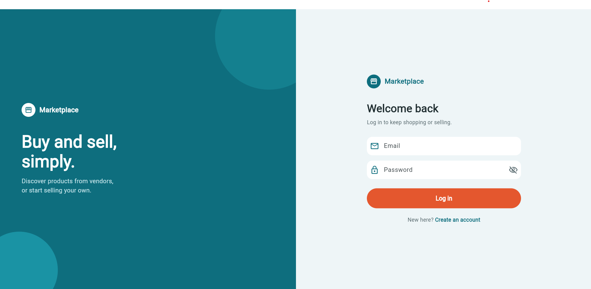<br>**Login** | 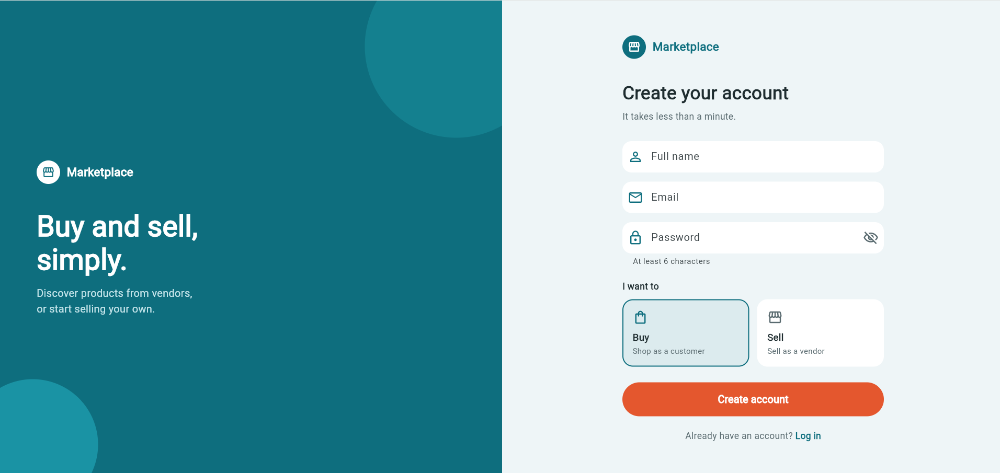<br>**Register** |
| 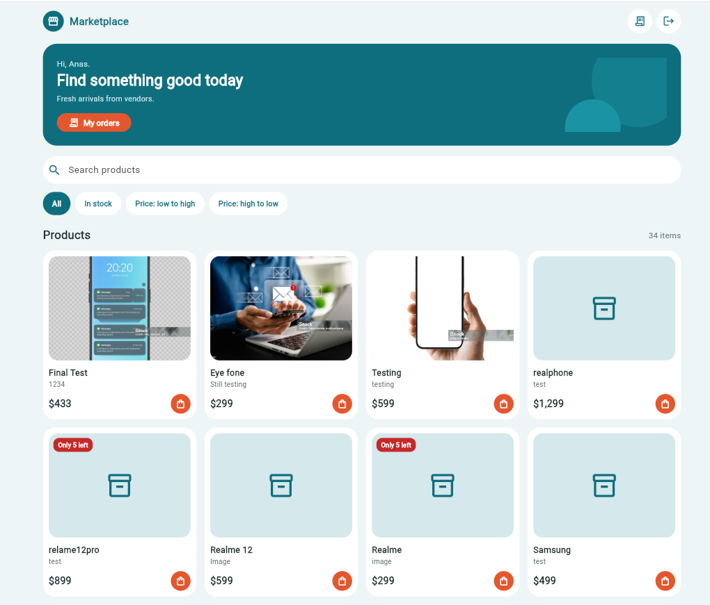<br>**Products (customer)** | 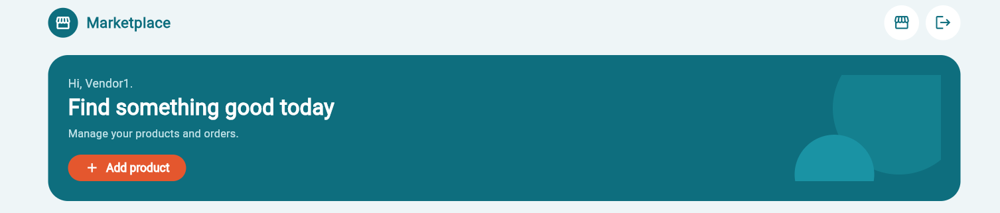<br>**Products (vendor)** |
| 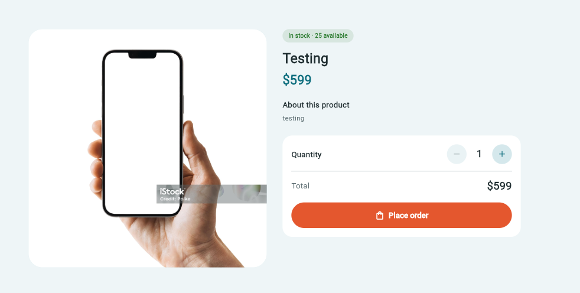<br>**Product detail** | 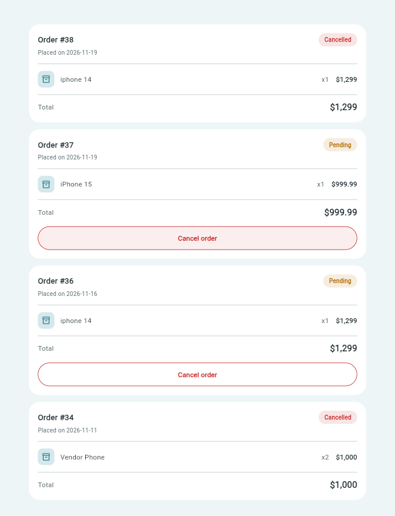<br>**My orders (customer)** |
| 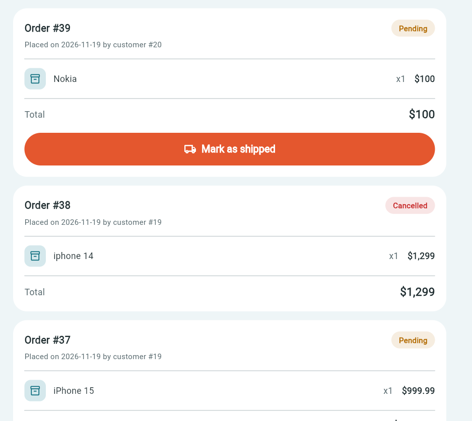<br>**All orders (admin)** | 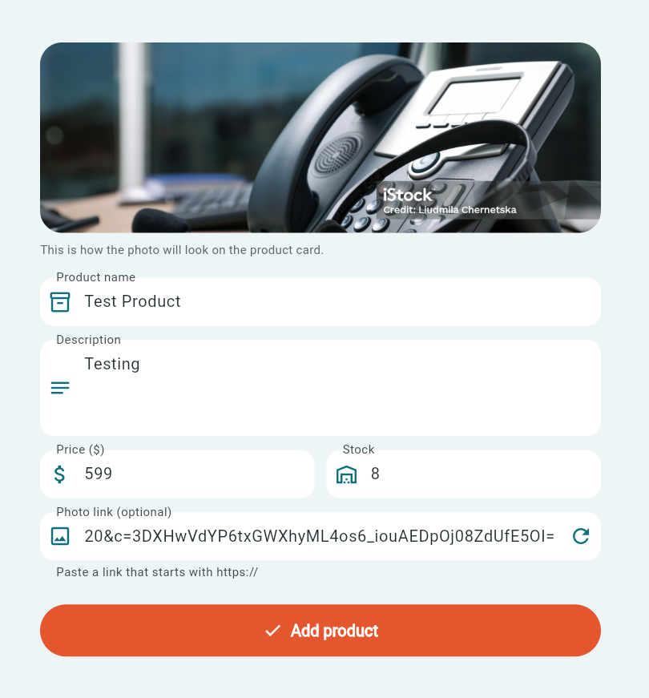<br>**Add product** |
| 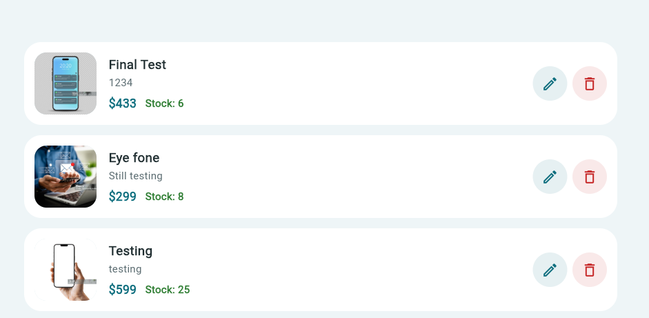<br>**My products (vendor)** | 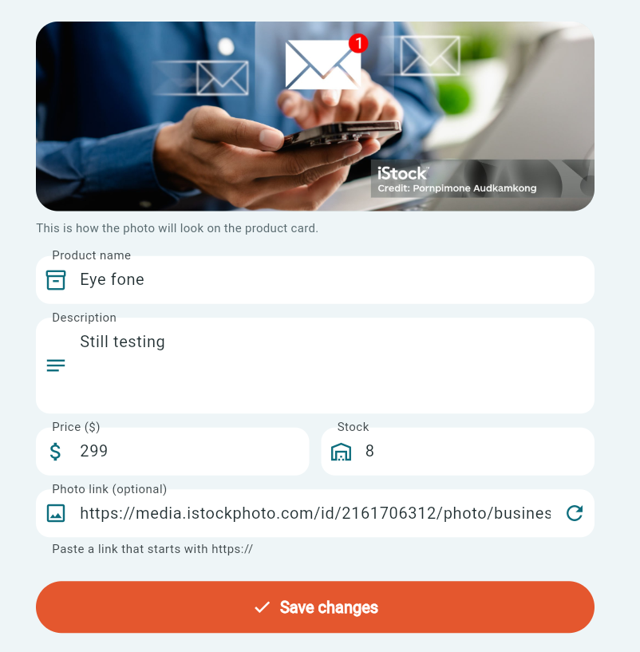<br>**Edit product** |

### Mobile width

<p>
  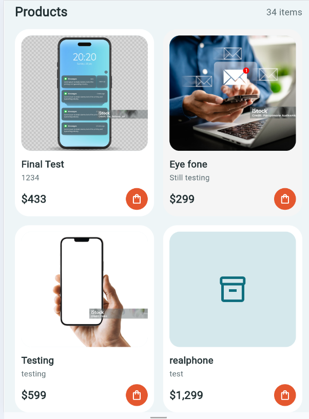
  &nbsp;
  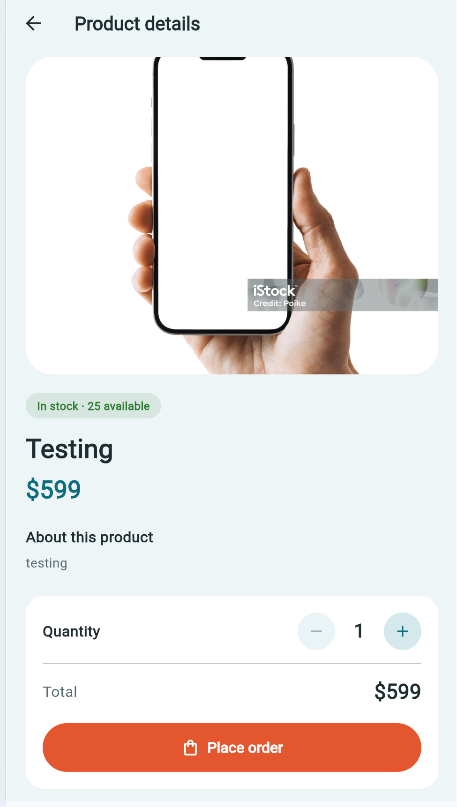
</p>

---

## Features

**Everyone**
- Create an account as a customer or a vendor, and log in
- Stay signed in between visits (the session expires after 7 days)
- Layout adapts from phone width to wide laptop screens

**Customers**
- Browse products with search, an "in stock" filter and price sorting
- Open a product, pick a quantity with plus and minus buttons, and see a live total
- Place orders, see order history, and cancel an order while it is still pending

**Vendors**
- Add products with a name, description, price, stock and an optional photo link
- See, edit and delete their own products on a "My products" screen

**Admin**
- See every customer's orders
- Move each order from Pending to Shipped to Delivered, one step at a time

---

## Tech stack

| | |
|---|---|
| UI | Flutter (web), Material 3 |
| State and navigation | GetX |
| HTTP | `http` package |
| Saved session | `shared_preferences` |
| Backend | [MarketPlace.API](https://github.com/anasnaeemqu/MarketPlace.API) (ASP.NET Core, JWT) |

---

## Getting started

**You need:** the [Flutter SDK](https://docs.flutter.dev/get-started/install), Google Chrome, and the API running locally (see the API repository).

```bash
git clone https://github.com/anasnaeemqu/MarketPlace.App.git
cd MarketPlace.App
flutter pub get
flutter run -d web-server --web-port=5000
```

Then open **http://localhost:5000** in Chrome.

- Port **5000** matters. The API only accepts browser requests from `http://localhost:5000` by default.
- The API address lives in one place, `lib/config.dart`. It defaults to `http://localhost:5033/api`.
- `web-server` mode does not open a browser for you, and it keeps your saved login between runs because you are using your normal Chrome profile.

---

## Project structure

```
lib/
├── main.dart                 # app start, theme, auto-login check
├── config.dart               # API address (the one place to change it)
├── theme/
│   └── app_theme.dart        # colours (Calm Ocean palette)
├── widgets/
│   ├── common.dart           # buttons, text fields, product image, layout helpers
│   └── product_form.dart     # shared form for add and edit product
├── controllers/              # GetX controllers: auth, products, orders
└── screens/                  # login, register, products, product detail,
                              # orders, add/edit product, my products
```

---

## Design

The colours follow a 60 / 30 / 10 split:

| Share | Colour | Used for |
|---|---|---|
| 60% | Mist `#EEF5F7` | Page backgrounds, with white cards on top |
| 30% | Deep teal `#0E6E7E` | Headers, icons, selected filters |
| 10% | Warm orange `#E4572E` | Actions only: buttons |

---

## Roadmap

- [ ] Vendor "sales" view: see who bought your products
- [ ] Deploy the app and API online
- [ ] Real photo upload instead of pasting a link
- [ ] Product categories
- [ ] Automated tests

---

## Notes

This is a learning project. Product photos come from links that vendors paste, so a photo only shows if the website hosting it allows other sites to use it.